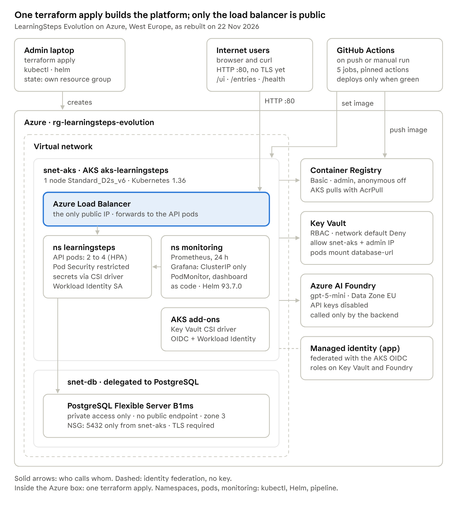
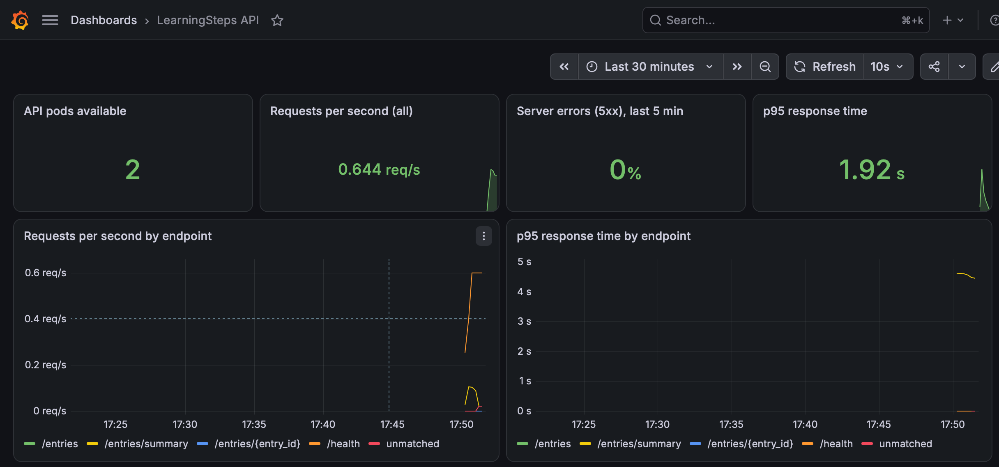
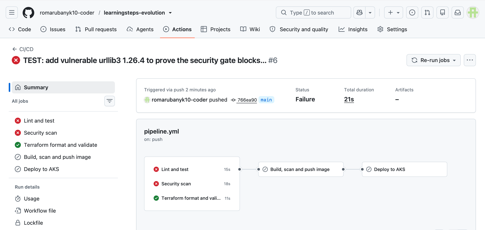
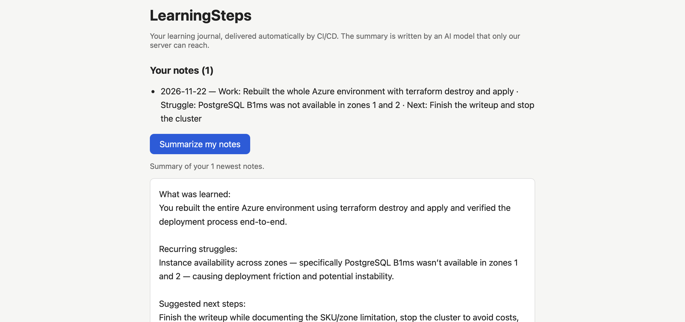

# LearningSteps Evolution — Technical Writeup

[](https://github.com/romarubanyk10-coder/learningsteps-evolution/actions/workflows/pipeline.yml)    

**From manual cloud deployment to an automated, secured and observable platform on Azure: CI/CD, Infrastructure as Code, Kubernetes and DevSecOps for the LearningSteps API**

|  |  |
| --- | --- |
| **Prepared by** | Roman Rubanyk, Cyber Analyst trainee |
| **Programme** | Cybersteps Weiterbildung · Cyberanalyst track · Module 3 |
| **Project** | LearningSteps Evolution (follows LearningSteps Origins) |
| **Project period** | 13 – 22 November 2026 (5 working days) |
| **Cloud** | Microsoft Azure · West Europe · resource group `rg-learningsteps-evolution` |
| **Repository** | [github.com/romarubanyk10-coder/learningsteps-evolution](https://github.com/romarubanyk10-coder/learningsteps-evolution) |
| **Document version** | 1.0 · final |
| **Classification** | Public — contains no secrets; public IP addresses and the subscription ID are removed from all screenshots |

### Executive summary

The LearningSteps API, deployed by hand on virtual machines in Origins, now runs on Azure Kubernetes Service and is delivered by a GitHub Actions pipeline that tests, scans, builds and deploys every change. All 30 Azure resources are declared in Terraform; the database, the key vault and the AI model have no public path, and the application holds no stored password or API key. The environment was destroyed and rebuilt from code on 22 November 2026 and came back working, including the AI summary.

| Result | Evidence |
| --- | --- |
| **Continuous deployment** — a code change goes live without manual steps | UI change live in 2 min 30 s; every deploy ends with a smoke test |
| **Security enforcement** — unsafe changes never reach Azure | Vulnerable `urllib3` and an insecure Terraform rule both stopped the pipeline |
| **Infrastructure recovery** — the platform is code | `terraform destroy` (30 resources, 7.5 min) and `apply`; app, AI and monitoring back the same day |
| **Observability** (optional) | Prometheus and Grafana, dashboard as code, live metrics after the rebuild |
| **AI feature** — “Your notes, now with an attention span” | `gpt-5-mini` summary reached only by the backend, through a managed identity, no key |

### Contents

1. [Project Overview](#project-overview)
2. [Architecture](#architecture)
3. [Repository Layout](#repository-layout)
4. [The Pipeline](#the-pipeline) — including the pipeline proofs
5. [Implementation Details](#implementation-details) — from the container image to AI, autoscaling, monitoring and recovery
6. [Verification against the Success Criteria](#verification-against-the-success-criteria)
7. [Security Decisions](#security-decisions)
8. [Challenges & Resolutions](#challenges--resolutions)
9. [Known Issues & Deferred Hardening](#known-issues--deferred-hardening)
10. [Key Learnings](#key-learnings)
11. [How to Rebuild the Environment](#how-to-rebuild-the-environment)
12. [Appendix: Resource Inventory, Lifecycle & Cost](#appendix-resource-inventory-lifecycle--cost)
13. [Evidence Index](#evidence-index)

---

## Project Overview

LearningSteps Evolution re-deploys the original LearningSteps FastAPI + PostgreSQL app on Azure as an automated, self-healing lifecycle: Terraform builds the infrastructure, Docker packages the app, AKS runs it, Key Vault holds the secrets and GitHub Actions builds, scans and deploys every change.

**Status:** Day 4 of 5. The API runs on AKS behind a public LoadBalancer with a private PostgreSQL database; the AI summary feature is live (image `v3`, commit `ed1d044`). Next: autoscaling (HPA) and the CI/CD pipeline.

| Layer | Evolution (this project) | Origins (manual, previous project) |
| --- | --- | --- |
| Infrastructure | Terraform code, `terraform apply` | Azure CLI and Portal, by hand |
| Packaging | Docker image in Azure Container Registry | Python venv on a VM |
| Orchestration | AKS: Deployment, LoadBalancer Service, HPA | One VM with systemd and nginx |
| Database | PostgreSQL Flexible Server, private access | PostgreSQL 16 on a second VM |
| Secrets | Azure Key Vault | `.env` file on the VM disk |
| Delivery | GitHub Actions: build, scan, push, deploy | SSH, git pull, systemctl restart |
| Health (optional) | Prometheus and Grafana | none |

**Success criteria (from the project brief):**

- **Continuous Deployment:** a pushed code change goes live on the Azure public IP automatically.
- **Security Enforcement:** the pipeline fails when a vulnerable package or an insecure Terraform rule is introduced.
- **Infrastructure Recovery:** `terraform destroy` and `terraform apply` recreate the whole environment. Done last, after every other result is collected.
- **(Optional) Visual Insights:** a live Grafana dashboard with real metrics from the API.

**Key facts:**

- Source code: [CyberstepsDE/learningsteps](https://github.com/CyberstepsDE/learningsteps), branch `reference`
- Repository: [romarubanyk10-coder/learningsteps-evolution](https://github.com/romarubanyk10-coder/learningsteps-evolution)
- Azure region: *to be decided (quota and PostgreSQL size check)*
- Public URL: *after the first deployment*

## Architecture

Everything in the Azure box below is declared in `infra-terraform/` and was created by a single `terraform apply`; the last rebuild from zero was on 22 November 2026. The only public entry point is the Azure Load Balancer in front of the API pods. The database, the vault and the AI model have no public path for application traffic.



*Figure 1 — Target architecture · 3 entry points, 1 public IP, 8 Azure building blocks.*

**How to read the diagram — five paths:**

| Path | Route | What protects it |
| --- | --- | --- |
| **Request** | User → Load Balancer (HTTP :80) → API pod → PostgreSQL :5432 | Database in a delegated private subnet; NSG allows 5432 only from `snet-aks`; TLS required; the app logs in as `learningsteps_app` (CRUD on one table only) |
| **Secrets** | API pod → Key Vault CSI driver → `database-url` mounted as a file | Workload Identity token instead of a stored password; vault network default **Deny**, allowed only from `snet-aks` and the admin IP |
| **AI** | API pod → Azure AI Foundry (`gpt-5-mini`) | API keys disabled; Entra ID token from the federated managed identity; Data Zone EU processing; the browser never talks to the model |
| **Release** | `git push` → GitHub Actions (5 jobs) → ACR → `kubectl set image` | Repository-scoped ACR token and a ServiceAccount that may patch one Deployment only; deploy runs only if lint, tests and all scans are green |
| **Infrastructure** | Admin laptop → `terraform apply` → Azure; state in a separate resource group | State storage accepts Entra ID only (no shared key); recovery proven with `terraform destroy` + `apply` |

**The platform running after the rebuild.** The Grafana dashboard below was installed from git (Helm chart 93.7.0, dashboard as code) on the freshly rebuilt cluster: two API pods, 0 % server errors, p95 latency 1.92 s; the slowest endpoint is `/entries/summary` (about 5 s of model time).



*Figure 2 — Live metrics from the rebuilt cluster (`DAY5_step8a_monitoring_restored.png`).*

## Repository Layout

The repository follows the layout from the project brief (commit `c6624a6`). Empty folders hold a `.gitkeep` file until their day comes.

| Path | What it holds | Filled on |
| --- | --- | --- |
| `app/` | FastAPI source code (moved from `api/` with `git mv`, history kept) | Day 1 |
| `infra-terraform/` | Terraform code for all Azure resources | Day 2 |
| `k8s-manifests/` | Kubernetes manifests: Deployment, Service, ConfigMap, HPA | Day 3 |
| `.github/workflows/` | GitHub Actions pipelines | Day 4 |
| `database_setup.sql` | Table and index definition from the original project | Day 3 |
| `start.sh`, `.vscode/launch.json` | Local run helpers, paths updated from `api` to `app` | Day 1 |

*The Dockerfile and the docs folder follow.*

## The Pipeline

The GitHub Actions workflow `.github/workflows/pipeline.yml` runs on every push and pull request to `main`. Pull requests only run the checks; a push to `main` also builds and deploys. The whole run takes about 2 minutes (run #4: 1m 54s).

| Stage (job) | Runs after | What it does | Stops the pipeline when |
| --- | --- | --- | --- |
| Lint and test | push / PR | `ruff check`, `pytest` (16 tests) on a clean Ubuntu runner with Python 3.13 | a lint error or a failing test |
| Security scan | push / PR (parallel) | trufflehog on the pushed commits (verified and unknown results); `trivy fs` for vulnerable dependencies; `trivy config` for Terraform, Kubernetes and the Dockerfile with `.trivyignore.yaml` | a secret, or a HIGH/CRITICAL finding |
| Build, scan and push image | both checks green, push only | `docker build`, image tag = first 7 characters of the commit SHA; `trivy image`; push to ACR with the repository-scoped token | a HIGH/CRITICAL vulnerability in the image (the image is never pushed) |
| Deploy to AKS | image pushed | `kubectl set image` with the `github-deployer` kubeconfig, `kubectl rollout status`, prints the running image, smoke test `curl --fail` on `/health` with retries | rollout not ready within 3 minutes, or `/health` not answering |

**Pipeline hardening:** the default `GITHUB_TOKEN` is read-only (`permissions: contents: read`); every action is pinned to a full commit SHA instead of a tag (supply-chain protection, see the tj-actions/changed-files incident of March 2025); checkout does not keep credentials; secrets and outputs reach shell commands through `env:` rather than inline `${{ }}` (no script injection); the ACR password goes to `docker login --password-stdin`; the kubeconfig is written to an owner-only temporary file and deleted with `if: always()`; the public address is stored as a secret so it is masked in public logs; `concurrency` prevents two deployments of `main` at the same time.

**What this proves:** run #4 (commit `7f7cd21`) passed all four jobs; the Deployment now runs `acrlearningstepsevo.azurecr.io/learningsteps-api:7f7cd21`, and ACR holds the robot-built tags next to the manual `v1`–`v3`. Screenshots: `DAY4_step6c_ci-lint-test.png`, `DAY4_step6d_ci-security-scan.png`, `DAY4_step6e_ci-build-push.png`, `DAY4_step6e_acr-tags.png`, `DAY4_step6f_ci-cd-full.png`.

One-time history audit: trufflehog over the whole git history found 0 verified secrets and 1 unverified result, the placeholder `postgres:postgres` connection string in `.env-sample` inherited from the upstream repository (a template for local Docker Compose, not a real credential). Screenshot: `DAY4_step6d_trufflehog-history.png`.

### Pipeline proofs: the gates really stop the line

A green pipeline alone does not prove that the gates work, so two deliberately unsafe commits were pushed to `main` and reverted with `git revert` (history kept, no force-push).

| Proof | Unsafe change | What stopped it | Build / deploy | Running image afterwards |
| --- | --- | --- | --- | --- |
| 1. Vulnerable dependency (commit `766ea90`, run #6) | `urllib3==1.26.4` added to `app/requirements.txt` | `trivy fs`: 8 HIGH (incl. CVE-2021-33503); tests also failed because the newer libraries need urllib3 2.x | skipped; no tag `766ea90` in ACR | unchanged `94f0692` |
| 2. Insecure Terraform (commit `91c92cd`, run #8) | PostgreSQL NSG rule source changed from the AKS subnet to `"*"` | `trivy config`: AZU-0047 CRITICAL (unrestricted ingress) and AZU-0074 HIGH (port 5432 from any IP), while `terraform validate` passed | skipped | unchanged |

`requests==2.20.0` (suggested in the course material) was not used: its known issues are mostly MEDIUM, and `azure-identity` needs a newer `requests`, so installation would fail before any scan. Proof 2 shows why both Terraform checks are needed: `validate` checks that the configuration is well-formed, `trivy config` that it is safe. The insecure rule never reached Azure because the pipeline does not run `terraform apply`; after the revert, `terraform plan -detailed-exitcode` returned 0 (no changes).

Screenshots: `DAY5_step2a_gate-blocked.png`, `DAY5_step2b_gate-finding.png`, `DAY5_step3a_tf-gate-blocked.png`, `DAY5_step3b_tf-finding.png`.



*Figure 3 — Proof 1: a vulnerable dependency stops the line. Lint/test and the security scan fail, so build and deploy never start (`DAY5_step2a_gate-blocked.png`).*

## Implementation Details

### Repository and source code

The project lives in a new standalone repository built from the `reference` branch of the original LearningSteps code.

| Item | Setting | Why |
| --- | --- | --- |
| Repository | `romarubanyk10-coder/learningsteps-evolution`, public | Standalone, not a fork: commits in a fork do not count on the GitHub profile, and Actions are off in forks by default |
| Source | Branch `reference` of `CyberstepsDE/learningsteps`, commit `ac76258` | All CRUD endpoints are implemented there; `main` still has TODO stubs |
| Default branch | `main`, renamed from `reference` | The pipeline will deploy from `main` |
| Remote `upstream` | The original repository, push URL set to `DISABLED` | Keeps the link to the original; an accidental push to it fails |
| Remote `origin` | The new repository | All work is pushed here |
| `.gitignore` | `.env` is ignored | Local secrets cannot reach the public repository |

**What this proves:** the local copy and GitHub hold the same commit (`ac76258`), the only push target is the new repository, and the local `.env` file cannot be committed by accident.

### Health and metrics endpoints

The API now answers two operational endpoints (commit `9a31b1a`).

| Item | Setting | Why |
| --- | --- | --- |
| `GET /health` | Returns `{"status": "ok"}` while the process runs | Kubernetes liveness and readiness probes |
| `GET /metrics` | Prometheus text format, hidden from Swagger | Scraped by Prometheus for the Grafana dashboard |
| `http_requests_total` | Counter with labels `method`, `endpoint`, `status` | Request volume and error rate |
| `http_request_duration_seconds` | Histogram with labels `method`, `endpoint` | Latency percentiles |
| Middleware | `try` / `finally` around every request | Requests that crash are still counted, as status `500` |
| Endpoint label | Route template, e.g. `/entries/{entry_id}` | Keeps one series per route instead of one per entry ID |

**What this proves:** in a local test, `/health` returned `{"status": "ok"}` and `/metrics` counted both a successful request and a failed one (`status="500"`).

### Automated tests

Five `pytest` tests run against the real application code with an in-memory fake in place of PostgreSQL (commit `2c79881`). They need no database and finish in about one second, so the pipeline can run them on every push.

| Test | What it checks |
| --- | --- |
| `test_health_returns_ok` | `/health` answers `200` with `{"status": "ok"}` |
| `test_metrics_counts_requests` | `/metrics` answers and contains `http_requests_total` |
| `test_create_and_read_entry` | An entry created with `POST` can be read back with `GET` |
| `test_unknown_entry_returns_404` | A missing entry returns `404` |
| `test_too_short_text_is_rejected` | Text shorter than 3 characters returns `422` |

| Setting | Value | Why |
| --- | --- | --- |
| `pytest.ini` | `pythonpath = app`, `testpaths = tests` | Tests import the app modules directly; the old manual script in the root is ignored |
| Local Python | 3.13 in `.venv` (ignored by Git) | 3.15 is too new for some compiled packages |

**What this proves:** the run ended with `5 passed` (screenshot `DAY1_step5_pytest-passed.png`).

### PATCH fix (test first)

The original PATCH endpoint erased every field that was not in the request and accepted any input. Both defects were first caught by new tests (red), then fixed (green), commit `f3b14b5`.

| Layer | Change | Why |
| --- | --- | --- |
| Model `EntryUpdate` | All fields optional; a field that is sent must be 3–256 characters | PATCH now follows the same text rule as POST |
| Router | Takes `EntryUpdate` instead of a plain `dict`; an empty update returns `400` | Invalid input is rejected with `422` before it reaches the service |
| Service | Merges `**existing_entry` first, then `**updated_data` | Fields that were not sent keep their stored values |
| Tests | The fake now replaces only the database (`FakeDB`); the real service runs | The bug lived in the service, so the service must run in the test |

**What this proves:** before the fix the run showed `2 failed, 5 passed` with `assert '' == 'Multi-stage builds'` and `assert 200 == 422`; after the fix it showed `7 passed` (screenshots `DAY1_step6a_patch-test-red.png`, `DAY1_step6b_patch-test-green.png`).

### Linting with ruff

`ruff` checks the code text for obvious mistakes without running it (commit `477f6de`).

| Setting | Value | Why |
| --- | --- | --- |
| `ruff.toml` | `select = ["E", "F"]`, `ignore = ["E501"]` | `F` catches real bugs (unused imports, undefined names); the default rule set flagged 61 style items in the original code, which are out of scope |
| Scope | `ruff check app tests` | Only the deployed app and our tests; the old manual script `test_api.py` in the root is left as it was |
| Findings | 2 × `F401` unused imports (`logging`, `asynccontextmanager`) | Removed with `ruff check --fix` |

**What this proves:** `ruff check app tests` reports `All checks passed!` and `pytest` still reports `7 passed` (screenshot `DAY1_step7_ruff-clean.png`).

### Container image

The app is packed into one Docker image, `learningsteps-api`, built from the `Dockerfile` in the repository root.

| Item | Setting | Why |
| --- | --- | --- |
| Base image | `python:3.13-slim` | Small Debian base: fewer packages, smaller attack surface |
| OS patches | `apt-get update && apt-get upgrade -y` at build time | Closes known vulnerabilities in the base image packages |
| User | `appuser`, UID `10001`, set with `USER` | The app never runs as root; Kubernetes can enforce non-root later |
| Layer order | `requirements.txt` and `pip install` before `COPY app/` | Code changes rebuild only the last layer |
| Health check | `HEALTHCHECK` calls `/health` every 30 s | Docker marks the container `healthy` or `unhealthy` |
| Secrets | None in the image; `DATABASE_URL` is passed at run time | The image will be stored in a registry and must not carry credentials |
| `.dockerignore` | Excludes `.git`, `.venv`, `.env`, tests, docs, infrastructure folders | Smaller build context; `.env` can never be copied in by mistake |

**What this proves:** the image built locally (327 MB on disk, 71.1 MB content). A container started from it reported `Up 2 minutes (healthy)`, `whoami` inside it returned `appuser`, and `/metrics` showed `http_requests_total{endpoint="/health",method="GET",status="200"} 4.0` — the four calls made by Docker's own health check.

### Local run with Docker Compose

`compose.yaml` starts two containers: the API (built from the Dockerfile) and the official `postgres:16` image. They talk over a private Compose network, where the API reaches the database by its service name `db`.

- **Schema on first start.** `database_setup.sql` is mounted into `/docker-entrypoint-initdb.d`, so PostgreSQL creates the `entries` table the first time the volume is empty.
- **Start order.** The database has a `pg_isready` healthcheck; the API uses `depends_on: condition: service_healthy`, so it starts only after the database accepts connections.
- **Persistence.** Data lives in the named volume `db-data`, not inside the container.
- **Private database.** Only the API port is published, and only on `127.0.0.1:8000`. Port 5432 is not published at all.
- **No secret in git.** The database password comes from a local `.env` file (random 32-character value from `openssl rand -hex 16`), which is in `.gitignore`. Compose refuses to start if it is missing (`${POSTGRES_PASSWORD:?…}`).

End-to-end check against the real database (commit `1d18818`):

| Check | Result |
| --- | --- |
| POST, then GET | entry created and read back |
| PATCH only `intention` | `intention` changed, `work` and `struggle` kept, `updated_at` moved forward |
| PATCH with a 2-character text | `422` |
| `psql` inside the `db` container | 1 row with the updated values |
| `docker compose down`, then `up` | containers deleted and recreated; the entry is still there |
| DELETE, then GET | `404` |
| `nc -vz localhost 5432` from the host | `Connection refused` |

Screenshots: `DAY1_step9a_crud-psql-real-db.png`, `DAY1_step9b_persistence-after-down-up.png`, `DAY1_step9c_db-port-refused.png`.

### Image vulnerability scan with Trivy

Trivy lists every package inside the image (Debian system packages and Python libraries) with its version and compares the list against public vulnerability databases (CVE and GitHub advisories). The same check becomes a blocking gate in the pipeline on Day 4.

```bash
trivy image --scanners vuln --severity HIGH,CRITICAL --ignore-unfixed --exit-code 1 learningsteps-api:dev
```

- `--severity HIGH,CRITICAL` reports only the levels the brief asks the pipeline to fail on.
- `--ignore-unfixed` skips findings that have no fixed version yet, because no update could remove them.
- `--exit-code 1` makes the command fail when anything is found, which is what stops a CI job.

| Scan | Debian 13.7 (87 packages) | Python | Exit code |
| --- | --- | --- | --- |
| First scan | 0 | 5 HIGH | `1` |
| After removing pip (commit `bb25cd0`) | 0 | 0 | `0` |

All five findings were in libraries we never installed: `msgpack 1.1.2`, `urllib3 2.7.0` and `setuptools 70.3.0`. They are copies that pip bundles inside itself (`pip/_vendor/vendor.txt` in pip 26.2.2 lists exactly these versions). The application does not use pip at runtime, so the Dockerfile now uninstalls it in the same `RUN` step that installs the requirements:

```dockerfile
RUN pip install --no-cache-dir --requirement requirements.txt \
  && pip uninstall --yes pip
```

**What this proves:** the rebuilt container still answers `/health`, `python -m pip` inside it fails with `No module named pip`, and the rescan ends with `exit code: 0`. Screenshots: `DAY1_step10a_trivy-clean.png`, `DAY1_step10b_no-pip-in-runtime.png`.

### Infrastructure as Code with Terraform

All Azure resources of the project are described in `infra-terraform/` and created with `terraform plan -out tfplan` followed by `terraform apply tfplan`, so only a reviewed plan is ever applied. Provider: `hashicorp/azurerm ~> 5.14` (current major version; the instructor solution uses 3.x). In v5 the provider no longer registers Azure resource providers on its own, so the seven that the project needs are listed explicitly.

**Remote state.** The state file lives in a separate resource group (`rg-learningsteps-tfstate`) in a hardened storage account: TLS 1.2 minimum, HTTPS only, public blob access impossible, shared-key access disabled (Entra ID only, `use_azuread_auth = true`), blob versioning on. The backend locks the state during every plan and apply. The subscription ID is passed through `ARM_SUBSCRIPTION_ID` and never written to git; `.tfstate`, `tfplan` and `*.tfvars` are git-ignored, while `.terraform.lock.hcl` is committed to pin the provider checksum.

| Resource | Key settings | Why |
| --- | --- | --- |
| `vnet-learningsteps` 10.20.0.0/16 | `snet-aks` /22, `snet-db` /24 delegated to PostgreSQL Flexible Server | private network for the cluster and the database |
| `nsg-snet-db` | 100 allow 5432 from `snet-aks`, 110 allow 5432 inside `snet-db`, 4000 deny other VNet traffic | least privilege: only the cluster can reach the database port |
| Private DNS zone `learningsteps.private.postgres.database.azure.com` | linked to the VNet | the database name resolves to a private IP only inside the VNet |
| `acrlearningstepsevo` (Basic) | admin user and anonymous pull disabled | images pulled and pushed only with Entra ID identities |
| `aks-learningsteps` | 1 × Standard\_D2s\_v6, Kubernetes 1.36, Azure CNI overlay + Cilium network policy, RBAC, OIDC issuer, Workload Identity, Key Vault CSI driver, OS disk 30 GB | runs the API; identities instead of passwords |
| Role assignments | kubelet → `AcrPull` on the registry only; cluster → `Network Contributor` on `snet-aks` only | narrowest scope that works |
| `kv-learningsteps-evo` | RBAC authorization, default action Deny, bypass None, allowed: the operator's IP (kept in `terraform.tfvars`, not in git) and `snet-aks` via a `Microsoft.KeyVault` service endpoint; soft delete 7 days | two independent locks: network and role |

**Lab-specific detail.** Azure adds a `created-on` tag to new resources. Every tagged resource ignores that one key (`lifecycle { ignore_changes = [tags["created-on"]] }`), so plans show only real changes.

**What this proves:** the AKS node is `Ready` with internal IP `10.20.0.4` from `snet-aks` and no external IP, and `az aks check-acr` reports `Validating image pull permission: SUCCEEDED`. The Key Vault reports `rbac True`, `defaultAction Deny`, `bypass None`, one allowed subnet. Screenshots: `DAY2_step2_…` to `DAY2_step6_keyvault-deny-by-default.png`.

**Private PostgreSQL.** `psql-learningsteps-evo` (PostgreSQL 16, `B_Standard_B1ms`, 32 GB, 7-day backups) sits in the delegated `snet-db` with `public_network_access_enabled = false`; its name resolves through the private DNS zone. The admin password is an `ephemeral "random_password"` (32 alphanumeric characters) passed only to write-only arguments: `administrator_password_wo` on the server and `value_wo` on the Key Vault secret `postgres-admin-password`. Ephemeral values and write-only arguments are never saved, so the password exists only in the server and in Key Vault; `terraform state pull` shows both fields empty. Rotation means raising `*_wo_version`. The secret `depends_on` the server, so a failed server create can never leave Key Vault with a password the server does not have.

**What this proves:** `az postgres flexible-server show` reports `Ready`, version 16, `Standard_B1ms`, `PublicAccess Disabled`; Key Vault lists `postgres-admin-password`; the state holds no password. Screenshot: `DAY3_step1_postgres-private-secret-in-kv.png`.

**Foundry (AI Services) for the AI summary feature.** `ais-learningsteps-evo` (`kind = AIServices`, S0) has a custom subdomain, which Entra ID token authentication requires, and `local_auth_enabled = false`, so API keys do not exist. The network ACL denies by default and allows only `snet-aks` (via a `Microsoft.CognitiveServices` service endpoint) and the operator's IP. The model deployment `gpt-5-mini` is pinned to version `2025-08-07` with the `DataZoneStandard` SKU, so requests are processed only in EU data centres (journal notes are personal data), and a capacity of 10K tokens per minute caps both throughput and spend.

**What this proves:** `disableLocalAuth True`, `defaultAction Deny`, one allowed subnet, deployment `gpt-5-mini 2025-08-07 DataZoneStandard 10`; `az cognitiveservices account keys list` fails with `Failed to list key. disableLocalAuth is set to be true`. Screenshot: `DAY3_step2_foundry-keys-disabled.png`.

**Application database role.** The API does not use the admin account. A one-time Kubernetes Job (`k8s-manifests/bootstrap/`), run inside the cluster because only `snet-aks` reaches the database, creates `learningsteps_app` with `SELECT, INSERT, UPDATE, DELETE` on `entries` only (`arwd`), and the table itself owned by the admin. The Job proves both sides: the app role reads the table, and `CREATE TABLE` as the app role fails with `permission denied for schema public`. The app password is an ephemeral value that Terraform writes to Key Vault twice (alone, and inside the `database-url` connection string with `sslmode=require`); the temporary Kubernetes Secret used by the Job was deleted with its namespace.

**Workload Identity for the app pods.** A user-assigned managed identity `id-learningsteps-app` has a federated credential that trusts exactly one subject, `system:serviceaccount:learningsteps:learningsteps-api`, from this cluster's OIDC issuer. It holds `Key Vault Secrets User` on the vault and `Cognitive Services OpenAI User` on the Foundry account, nothing else. The `learningsteps` namespace enforces Pod Security `restricted`. A `SecretProviderClass` tells the Key Vault CSI driver to fetch `database-url` with that identity and sync it into the Kubernetes Secret `learningsteps-db`. Client and tenant IDs are injected at apply time from `terraform output`, so the manifests survive a rebuild.

**What this proves:** a test pod running as that ServiceAccount, with no password or key anywhere in its spec, mounted `database-url` (152 bytes; only the length was printed) and the synced Secret appeared. Screenshots: `DAY3_step5_db-app-role-least-privilege.png`, `DAY3_step6_image-amd64-in-acr.png`.

### API on AKS: Deployment and LoadBalancer

The API runs as a Kubernetes Deployment (`k8s-manifests/03-deployment.yaml`) with two replicas, exposed by a Service of type `LoadBalancer` (`04-service.yaml`) on port 80 → container port 8000 (commit `4ea0231`). Both manifests pass `trivy config` with 0 findings.

| Setting | Value | Why |
| --- | --- | --- |
| Replicas / rollout | 2, `maxSurge 1`, `maxUnavailable 0` | A new pod must be ready before an old one stops, so updates cause no downtime |
| Identity | ServiceAccount `learningsteps-api`, label `azure.workload.identity/use`, `automountServiceAccountToken: false` | The pod gets an Entra ID token for Key Vault, but no Kubernetes API token it does not need |
| Secrets | `DATABASE_URL` from Secret `learningsteps-db`, synced by the Key Vault CSI volume | No password in the manifest, the image or git |
| Hardening | non-root UID 10001, seccomp `RuntimeDefault`, `readOnlyRootFilesystem`, all capabilities dropped, no privilege escalation; writable `/tmp` only (`emptyDir`) | Meets the namespace's Pod Security `restricted` level |
| Resources | requests 100m / 128Mi, limits 500m / 256Mi | One faulty pod cannot starve the node; requests are needed later for HPA |
| Probes | readiness and liveness on `/health` | Traffic goes only to ready pods; a hung pod is restarted |

**What this proves:**

- **Public access:** both pods `1/1 Running` with overlay IPs `192.168.0.x`; the Service received a public IP; `/health` returned `{"status":"ok"}` and Swagger loads from the internet.
- **End-to-end CRUD:** POST, GET and PATCH through the public IP write to and read from the private PostgreSQL server; PATCH changed only `intention` and kept `work` and `struggle`.
- **Persistence:** after `kubectl rollout restart` replaced both pods (new names), the same entry was returned unchanged, because data lives in PostgreSQL, not in the pods.
- **Self-healing:** after one pod was deleted, the Deployment started a replacement within about 20 seconds, while `/health` returned `200` on every request during the replacement.

Screenshots: `DAY3_step8_pods-and-loadbalancer.png`, `DAY3_step8_swagger-public.png`, `DAY3_step11_self-healing.png` (public IP hidden).

### AI summary: secure integration

The app has a "Summarize my notes" button on the page `/ui`. It calls our own backend (`POST /entries/summary`); the backend reads the newest 20 entries from PostgreSQL and asks the `gpt-5-mini` deployment in Azure AI Foundry (EU Data Zone) for a short summary (commits `e0687ea`, `3c04735`, `ed1d044`).

- **No API key exists.** Key-based access on the Foundry resource is disabled (`local_auth_enabled = false`). The backend signs in with AKS Workload Identity: the pod exchanges its Kubernetes token for a short-lived Entra ID token of the managed identity `id-learningsteps-app`, which has only the role *Cognitive Services OpenAI User*. The Python code uses `DefaultAzureCredential` and passes a token provider to the `openai` client instead of a key.
- **The browser never talks to the model.** The page calls only our API. A Content-Security-Policy with `connect-src 'self'` blocks requests to any other host, and a test fails if the browser code ever contains the model address or an auth header. Notes are rendered with `textContent`, so note text cannot run as script (XSS).
- **Nothing secret in git or in the image.** The repository and the image contain only the model address and the deployment name, set as plain environment variables in the Deployment. AKS itself injects `AZURE_CLIENT_ID`, `AZURE_TENANT_ID`, `AZURE_FEDERATED_TOKEN_FILE` and `AZURE_AUTHORITY_HOST`. The database password stays in Key Vault.
- **Network restriction.** Foundry accepts calls only from the AKS subnet (service endpoint) and the admin's IP.
- **Safe prompting and errors.** Our instructions are in the system message, and user notes are sent as JSON data in a separate user message (prompt-injection hardening). Input is capped at 20 entries and 500 characters per field, and output at 1,000 tokens. On model errors the user sees a generic 502, and logs record only the error type.
- **Tested before it was written (TDD).** Six tests with a fake model client were red first, then green after the implementation; three more tests cover the page. `pytest`: 16 passed, `ruff`: clean. Trivy found 0 High/Critical vulnerabilities in images `v2` and `v3`, including the 17 new dependencies.

| Image | What changed | Rebuilt layers |
| --- | --- | --- |
| `v2` | `openai`, `azure-identity`, summary endpoint | dependencies + code (pip step \~107 s) |
| `v3` | `/ui` page, CSP header | code only (build 1.5 s, all other layers cached) |

**What this proves:** `POST /entries/summary` through the public IP returned a three-part summary written by `gpt-5-mini`; inside the pod only the six `AZURE_*` variable names above exist and none holds a key; the `/ui` page shows the notes and the summary. Screenshots: `DAY4_step3_trivy-v2.png`, `DAY4_step4_ai-summary-ui.png` (address hidden).



*Figure 4 — The AI summary still works after `terraform destroy` + `apply`: the new managed identity reached the model on the first try, without any key (`DAY5_step7d_ui_summary_after_recovery.png`, address bar removed).*

### Autoscaling with HPA

A HorizontalPodAutoscaler (`k8s-manifests/05-hpa.yaml`, commit `4dcc6cc`) keeps 2 to 4 API pods and targets 70% average CPU, measured against the pod's CPU request of 100m. The minimum of 2 keeps the app available if one pod fails; the maximum of 4 caps cost and fits the single node. Scale-down waits for 2 minutes of low load so pods do not flap. `trivy config` reports 0 findings for the file.

Load test: a temporary `busybox` pod in the `default` namespace sent requests to `/health` in 8 parallel loops through the internal Service name (never to `/entries/summary`, which would cost money).

| Time (HPA age) | CPU vs target | Replicas |
| --- | --- | --- |
| 2m22s, idle | 2% / 70% | 2 |
| 3m, under load | 194% / 70% | 2 |
| 3m15s | 194% / 70% | 4 |
| 6m1s, load stopped | 2% / 70% | 4 |
| 7m1s, after the 2-minute window | 2% / 70% | 2 |

**What this proves:** the cluster added two pods about 15 seconds after CPU crossed the target and removed them after the stabilization window, without manual steps. Screenshots: `DAY4_step5a_hpa-scale-up.png`, `DAY4_step5b_hpa-scale-down.png`.

### Pipeline access: two narrow keys

The lab does not allow service principals, so GitHub Actions gets two separate, narrowly scoped credentials instead of an Azure login (commits `e141c5c`, `f00c3a9`).

| Credential | Can do | Cannot do | Lifetime | Where it lives |
| --- | --- | --- | --- | --- |
| ACR token `github-actions` (scope map `ci-push-learningsteps-api`) | read and write the repository `learningsteps-api` | delete images, read other repositories, change the registry | password expires after 30 days | GitHub secret `ACR_TOKEN_PASSWORD` |
| Kubernetes ServiceAccount `github-deployer` (Role + RoleBinding in `learningsteps`) | get and patch the Deployment `learningsteps-api`; list and watch Deployments and ReplicaSets | read Secrets, exec into pods, delete, touch other Deployments or namespaces | token capped by AKS at 24 hours | GitHub secret `KUBE_CONFIG` |

Terraform creates the ACR scope map and token but not the password; `az acr token credential generate` pipes the password straight into `gh secret set`, so it never reaches the Terraform state, the terminal or git. `scripts/ci-kubeconfig.sh` builds the kubeconfig in a temporary folder that is deleted on exit, prints only the expiry date, tests the permissions with `kubectl auth can-i` and stores the file with `gh secret set`. The username and the registry address are plain GitHub variables.

Trivy flagged the deployer Role with **KSV-0048** (MEDIUM: patch on Deployments allows running any workload). Patching the Deployment is the purpose of a deployer, so the finding is accepted in `.trivyignore.yaml` for this file only, with a written statement. Mitigations: one Deployment by name, one namespace, Pod Security `restricted` (no root or privileged pods), short-lived token. The remaining risk (a stolen token could deploy a foreign image that reads `DATABASE_URL`) is listed under Known Issues.

**What this proves:** `kubectl auth can-i` with the deployer kubeconfig answered `yes` for the 3 required actions and `no` for `get secrets`, `create pods/exec`, `delete deployment`, `patch` on another Deployment and `get pods`. Screenshots: `DAY4_step6a_github-secrets.png`, `DAY4_step6b_deployer-rbac.png`.

### Monitoring with Prometheus and Grafana

The app already exposes `/metrics` (request counter and latency histogram, labelled by method, route and status). The cluster side is the community chart `kube-prometheus-stack`, pinned to **93.7.0** and installed with Helm into its own namespace `monitoring` (Pod Security: enforce *baseline*, warn and audit *restricted*).

| Decision | Why |
| --- | --- |
| Slim values: no Alertmanager, no node-exporter, no default rules, no control-plane scrapers; retention 24 h | One small node; only what the dashboard needs |
| Grafana as `ClusterIP`, reached with `kubectl port-forward`; admin password piped to the clipboard | No second public endpoint, no password on screen |
| `PodMonitor` for `app: learningsteps-api`, every 15 s, `honorLabels: true` | Prometheus' own target label `endpoint` (the port name) overwrote the app's route label; honorLabels keeps the app's value |
| Dashboard as code: a ConfigMap labelled `grafana_dashboard: "1"` with 8 panels | Rebuilt in seconds after a reinstall; no clicking |
| 5xx panel uses `or vector(0)` | Shows 0 % instead of “No data” when there are no errors |

Panels: pods available, requests per second, 5xx share, p95 latency, each by route as well, plus CPU and memory per pod. Screenshots: `DAY5_step5a–d`, after the rebuild `DAY5_step8a_monitoring_restored.png` and `DAY5_step8b_monitoring_cpu_memory.png`.

### Infrastructure Recovery

The last step of the project: delete everything Terraform manages, rebuild it from code and bring the application back, using only files from the repository.

| Time (22 Nov) | Step | Result |
| --- | --- | --- |
| 15:26 – 15:34 | `terraform destroy` from a saved plan | 30 resources destroyed in 7.5 min; Key Vault and Foundry purged from soft-delete; state resource group kept |
| 15:40 – 16:33 | `terraform apply` | 23 resources at once; PostgreSQL B1ms needed zone 3 (Challenge 6), then 7 more |
| 16:35 – 16:50 | Cluster bootstrap | Namespace, Workload Identity ServiceAccount and SecretProviderClass with the **new** client ID; DB role and table by a one-off Job (Challenge 7) |
| 16:50 – 16:56 | New CI credentials | ACR token password, deployer kubeconfig, app URL — four commands, no secret printed |
| 17:20 – 17:30 | Pipeline | First manual run stopped by the secret scan (Challenge 8); after the fix, push and manual runs green, image `9d418dd` deployed |
| 17:37 | Application check | Entry created, AI summary returned by the new identity on the first try |
| 17:45 – 17:52 | Monitoring | Helm reinstall + PodMonitor + dashboard from git |
| 18:00 | Cost | AKS and PostgreSQL stopped |

**What this proves:** nothing in the environment was hand-made. **What it also shows:** Infrastructure as Code restores infrastructure, not data — the database came back empty, and the cluster contents (namespaces, monitoring) are rebuilt by scripts and the pipeline, not by Terraform. Screenshots: `DAY5_step6a_destroyed.png`, `DAY5_step6b_rebuilt.png`, `DAY5_step7b_full_history_scan_green.png`, `DAY5_step7d_ui_summary_after_recovery.png`.

## Verification against the Success Criteria

| Success criterion | Status | Evidence |
| --- | --- | --- |
| **Continuous Deployment** — push a code change and see it live on the public IP automatically | ✅ Met | Proof 3: a `/ui` text change went from push to live in 2 min 30 s (image tag = commit SHA); every deploy ends with `curl --fail` on `/health` |
| **Security Enforcement** — the pipeline fails on a vulnerable package or an insecure Terraform rule | ✅ Met | Proof 1: `urllib3 1.26.4` → 8 HIGH in `trivy fs`, build and deploy skipped (Figure 3). Proof 2: public storage rule → AZU-0047 CRITICAL in `trivy config`, while `terraform validate` passed |
| **Infrastructure Recovery** — `terraform destroy` and `apply` recreate the environment | ✅ Met | 30 resources destroyed and recreated on 22 Nov; app, AI and monitoring back (section Infrastructure Recovery) |
| **(Optional) Visual Insights** — live Grafana dashboard with real API metrics | ✅ Met | Dashboard as code, live after the rebuild (Figure 2) |
| **AI task** — summary of the notes, integrated securely | ✅ Met | Backend-only call to `gpt-5-mini`, managed identity, keys disabled, CSP on `/ui` (Figure 4) |
| Brief: containerisation, IaC, AKS with Key Vault secrets, autoscaling | ✅ Met | Dockerfile + Trivy 0 HIGH/CRITICAL; Terraform; CSI driver mounts `database-url`; HPA scaled 2 → 4 → 2 under load |

## Security Decisions

The guiding rule: **no stored credentials where an identity can be used, no network path that the application does not need, and no change that reaches Azure without passing the gates.**

| Area | Decision | Risk it removes |
| --- | --- | --- |
| **Identity** | App → Key Vault and Foundry with Workload Identity (federated managed identity); Foundry `local_auth_enabled = false` | Leaked API keys or connection secrets in code, images or environment |
| **Identity** | CI without service principals (not allowed in the lab): repository-scoped ACR token + Kubernetes ServiceAccount that may patch one Deployment | A stolen CI credential taking over the subscription or the cluster |
| **Identity** | Database user `learningsteps_app` with CRUD on one table, no DDL; admin password only for the bootstrap Job | SQL injection or app compromise altering the schema |
| **Network** | PostgreSQL with private access in a delegated subnet; NSG allows 5432 only from `snet-aks`; TLS required | Database reachable from the internet |
| **Network** | Key Vault and Foundry: network default Deny, allowed from `snet-aks` (service endpoints) and the admin IP | Secret or model access from anywhere else |
| **Network** | One public endpoint (the API load balancer); Grafana only through `port-forward` | Exposed admin interfaces |
| **Secrets** | Passwords generated by Terraform as ephemeral, written write-only to Key Vault, never in state; CI secrets piped from `az` straight into GitHub | Secrets in the state file, terminal history, chat or git |
| **Workloads** | Pod Security `restricted` on the app namespace; pip removed from the image; Trivy image scan 0 HIGH/CRITICAL | Root or privileged containers; known CVEs in production |
| **Supply chain** | Actions pinned by commit SHA; `permissions: contents: read`; secrets passed through `env:`; trufflehog, `trivy fs`, `trivy config`, `terraform validate` before build | Tampered actions, script injection, leaked secrets, vulnerable dependencies, insecure IaC |
| **Data and AI** | Model in Data Zone EU; the browser never calls the model; notes sent as data with a fixed system prompt; output rendered with `textContent`, strict CSP | Personal notes leaving the EU; prompt injection into the UI; XSS |

Accepted risks are written down rather than hidden: KSV-0048 for the deployer Role and the `.env-sample` exclusion in the secret scan are scoped to one file each, with a statement; the remaining gaps are listed under Known Issues.

## Challenges & Resolutions

| # | Symptom | Cause | Resolution |
| --- | --- | --- | --- |
| 1 | After commit `e93e2d5` all 12 files in `app/` were empty (0 bytes) on the laptop and on GitHub | Files were written through an assistant's folder connection, which truncated every file in the folder | `git restore --source=c6624a6 app/` brought the files back from the last good commit; the new code was added by hand and committed as `9a31b1a`. Lesson: check `git diff --stat` before every commit |
| 2 | `IndentationError: expected an indented block after class definition` in `app/models/entry.py` | The new class was pasted with the cursor already indented, so `class EntryUpdate` sat at the same level as its body | Moved `class` back to column 1; Python uses indentation as syntax |
| 3 | First Trivy scan: 5 HIGH CVEs in msgpack, urllib3 and setuptools, which are not in requirements.txt | pip bundles its own copies of these libraries, and pip comes with the python:3.13-slim base image. The newest pip (26.3) would still carry setuptools 70.3.0 (1 HIGH) | pip is not needed at runtime, so the Dockerfile uninstalls it right after installing the requirements. Rescan: 0 High/Critical, exit code 0 |
| 4 | PostgreSQL create failed with SkuNotAvailable for B\_Standard\_B1ms, although az postgres flexible-server list-skus listed it in all three zones; the Key Vault secret had already been written | Regional capacity in the zone Azure picked; secret and server were created in parallel, so a failed server left a password in Key Vault that no server had | Pinned zone = 1 (variable postgres\_zone); secret now depends\_on the server and its value\_wo\_version was raised to 2 so the retry rewrote it |
| 5 | terraform plan failed with ServerStoppedError late in the evening; AKS was stopped too | The activity log showed the lab's automation identity stopping AKS and PostgreSQL at 22:08 UTC | Sessions end before that time; every session starts with az aks start and az postgres flexible-server start |
| 6 | Recovery apply: PostgreSQL B1ms failed with SkuNotAvailable in zone 1 and again in zone 2; the next try in zone 3 failed with 'already exists' although nothing was listed | No B1ms capacity in those zones that afternoon. The failed zone-2 create left a half-made 'ghost' server that Azure removed by itself about five minutes later | postgres\_zone = "3" in terraform.tfvars (not in git); waited until az postgres flexible-server show returned ResourceNotFound, then apply added the last 7 resources. Lesson: after a failed create, check and wait before retrying |
| 7 | After Recovery the bootstrap Job would have given the app role a password that DATABASE\_URL does not contain | Ephemeral passwords are generated anew in every apply. postgres-app-password was written in apply 1, database-url in apply 3, so the two secrets held different passwords | The bootstrap step now takes APP\_PASSWORD from the database-url secret itself (parsed with urllib.parse, passed by file). The Job's check 2 logged in as learningsteps\_app with that password |
| 8 | First manual pipeline run (workflow\_dispatch) failed in trufflehog: 'Found unverified Postgres result' in .env-sample line 9 | On push, trufflehog scans only the new commits; a manual run has no 'before' commit and scans the whole history. .env-sample from the first commit holds the local docker-compose defaults (postgres/postgres on host postgres). The host cannot be reached, so the result is 'unknown', and the pipeline fails on unknown by design | Exact-path exclusion ^\\.env-sample$ in .trufflehog-exclude.txt, passed with --exclude-paths; every other file and the unknown rule stay. A second full-history run was green (run 45044213966) |

## Known Issues & Deferred Hardening

| Gap | Why it is acceptable now | Planned fix (Lockdown) |
| --- | --- | --- |
| `/metrics` will be reachable from the internet with the API | It shows request statistics only, no secrets | Serve metrics on an internal port or restrict it with a NetworkPolicy |
| pip's files still exist in the base image layer, although the running container cannot reach them; Python dependencies are not pinned | Trivy scans the final filesystem and reports 0 High/Critical; the pipeline scan catches any new finding before deploy | Multi-stage build that copies only the installed packages into the final image; pin versions in requirements.txt |
| The API is served over plain HTTP on a public IP, and Swagger (/docs) is open to everyone | Learning project with test data only; no login or personal data travels over the connection yet | Ingress controller with a TLS certificate (cert-manager) and a domain; disable /docs in production or restrict it by IP |
| POST /entries/summary has no authentication and no rate limit, so anyone who knows the public IP can trigger paid model calls | Each call is capped (20 entries, 1,000 output tokens, capacity 10K tokens/min on the deployment), and the cluster is stopped outside work sessions | Add user authentication and a per-client rate limit (for example in an ingress controller); add a budget alert on the Foundry resource |
| A stolen deployer token could point the Deployment at a foreign image, which would receive DATABASE\_URL; the cluster accepts images from any registry | The token lives only in GitHub Secrets and expires after 24 hours; Pod Security 'restricted' prevents root or privileged pods | Allow only images from our ACR (Azure Policy for AKS or an admission controller) and sign images; switch CI to OIDC federation if service principals become available |
| Repository secret scan skips .env-sample | The file holds only public local defaults; its header says real values belong in the git-ignored .env | Pre-commit hook that rejects any change to .env-sample containing a value other than the documented defaults |
| CI credentials expire: KUBE\_CONFIG after 24 hours, the ACR token password after 30 days | Short lifetimes limit damage; refreshing is one script (./scripts/ci-kubeconfig.sh) and one piped command | OIDC federation for GitHub Actions once service principals are allowed; until then a calendar reminder |
| The two database secrets (postgres-app-password and database-url) are written in different Terraform resources and can drift apart | The bootstrap reads the password from database-url, the only secret the app uses | Write both from one ephemeral value in the same apply, or drop postgres-app-password |
| Git says image v3, the cluster runs the SHA tag set by the pipeline | The pipeline is the only way images change; the running tag is printed in every deploy log | GitOps (Argo CD or Flux) so the desired image lives in git |
| Monitoring is installed with Helm, not with Terraform, and Prometheus keeps data on an emptyDir (lost on restart) | Chart version, values, PodMonitor and dashboard are in git; reinstall takes one Helm command and one kubectl apply | Helm release in Terraform (or GitOps) and a persistent volume if history is needed |

## Key Learnings

1. **A pipeline is a set of gates, not a script.** Its value showed when it said no: a vulnerable package and an insecure Terraform rule were stopped before they reached Azure, and a deploy that cannot pass its own smoke test does not count as done.
2. **Different checks see different things.** `terraform validate` says the code is well-formed, `trivy config` says it is safe. A push scan sees only the diff, a full-history scan sees everything — and found a file no push had ever shown it.
3. **Identity beats secrets.** With Workload Identity the app reaches Key Vault and the AI model without any stored key. After the rebuild the new identity simply worked, because nothing secret had to be copied.
4. **Infrastructure as Code restores infrastructure, not data.** `terraform apply` rebuilt 30 resources; the database came back empty, and namespaces, CI credentials and monitoring needed their own scripts. A real recovery plan needs backups and a runbook, not only Terraform.
5. **Least privilege has to be tested, not just written.** `kubectl auth can-i` proved what the deployer can and cannot do; the bootstrap Job proved the app user cannot create tables.
6. **Cloud capacity is not guaranteed.** A SKU that is listed can still be unavailable in a zone; a failed create can leave a ghost resource. Check, wait, then retry.
7. **Kubernetes is declarative.** Re-running the same deploy changed nothing and took 7 seconds — the cluster compares desired and actual state, which makes repeated runs safe.
8. **Write down accepted risks.** Every exception (KSV-0048, the `.env-sample` exclusion, plain HTTP) is scoped, explained and listed, so the next phase (Lockdown) starts from a known list.

## How to Rebuild the Environment

Runbook used on 22 November 2026. Prerequisites: `az`, `terraform`, `kubectl`, `helm`, `gh` logged in; `infra-terraform/terraform.tfvars` (not in git) with the admin IP and `postgres_zone`.

1. **Infrastructure** — `terraform -chdir=infra-terraform apply`, then `az aks get-credentials`.
2. **Namespace and identity** — apply `00-namespace.yaml`; render `01-serviceaccount.yaml` and `02-secretproviderclass.yaml` with the new client and tenant IDs from `terraform output` (`sed` on the placeholders, piped to `kubectl apply -f -`).
3. **Database** — temporary namespace `db-bootstrap`; Secret from files: admin password from Key Vault, app password parsed from `database-url`; run `db-bootstrap-job.yaml`, read its three checks, delete the namespace.
4. **Workload** — apply Deployment, Service, HPA and `ci/github-deployer.yaml`. Pods wait in `ImagePullBackOff` until the pipeline delivers an image.
5. **CI credentials** — `az acr token credential generate … | gh secret set ACR_TOKEN_PASSWORD`; `./scripts/ci-kubeconfig.sh`; new load balancer IP piped into `APP_URL`.
6. **Deliver** — `gh workflow run pipeline.yml`; wait for 5 green jobs; check pods, image tag, `/ui` and the AI summary.
7. **Monitoring** — `helm upgrade --install monitoring prometheus-community/kube-prometheus-stack --version 93.7.0 -f k8s-manifests/monitoring/values.yaml`, then apply the PodMonitor and the dashboard.
8. **Park** — `az aks stop` and `az postgres flexible-server stop`.

Total on 22 Nov: about 2.5 hours from `destroy` to a working app, including the three problems in Challenges 6–8; without them, under an hour.

## Appendix: Resource Inventory, Lifecycle & Cost

**Resource inventory** (`rg-learningsteps-evolution`, West Europe, all created by Terraform)

| Resource | Name | Size / tier | Billing |
| --- | --- | --- | --- |
| AKS cluster | `aks-learningsteps` | 1 × Standard\_D2s\_v6, Kubernetes 1.36 | per hour while running — stopped between sessions |
| PostgreSQL Flexible Server | `psql-learningsteps-evo` | Burstable B1ms, zone 3 | per hour while running — stopped between sessions |
| Container Registry | `acrlearningstepsevo` | Basic | per day |
| Key Vault | `kv-learningsteps-evo` | Standard, RBAC | per operation |
| Azure AI Foundry | `ais-learningsteps-evo` | `gpt-5-mini`, Data Zone Standard | per token |
| Network | VNet, `snet-aks`, `snet-db`, NSG | — | free; public IP of the load balancer per hour |
| Managed identity | app identity + federated credential | — | free |
| Terraform state | `rg-learningsteps-tfstate` (separate, outside destroy) | Storage, LRS | cents per month |

**Lifecycle**

- Start a session: `az aks start` and `az postgres flexible-server start`; refresh `KUBE_CONFIG` with `./scripts/ci-kubeconfig.sh` (24-hour token).
- End a session: `az aks stop` and `az postgres flexible-server stop`. The lab automation also stops both at 22:08 UTC. A stopped PostgreSQL server starts again by itself after 7 days.
- After grading: `az group delete --name rg-learningsteps-evolution`, then the state resource group. Origins resources stay deallocated as the instructor asked.

## Evidence Index

All screenshots are in [`docs/screenshots/`](docs/screenshots/). Public IP addresses, the subscription ID and the admin IP are removed or cropped.

| Day | Focus | Screenshots |
| --- | --- | --- |
| 1 | App, tests, container image | [step10a_trivy-clean](docs/screenshots/DAY1_step10a_trivy-clean.png) · [step10b_no-pip-in-runtime](docs/screenshots/DAY1_step10b_no-pip-in-runtime.png) · [step1_origins-vms-deallocated](docs/screenshots/DAY1_step1_origins-vms-deallocated.png) · [step3_commit-push](docs/screenshots/DAY1_step3_commit-push.png) · [step5_pytest-passed](docs/screenshots/DAY1_step5_pytest-passed.png) · [step6a_patch-test-red](docs/screenshots/DAY1_step6a_patch-test-red.png) · [step6b_patch-test-green](docs/screenshots/DAY1_step6b_patch-test-green.png) · [step7_ruff-clean](docs/screenshots/DAY1_step7_ruff-clean.png) · [step9a_crud-psql-real-db](docs/screenshots/DAY1_step9a_crud-psql-real-db.png) · [step9b_persistence-after-down-up](docs/screenshots/DAY1_step9b_persistence-after-down-up.png) · [step9c_db-port-refused](docs/screenshots/DAY1_step9c_db-port-refused.png) |
| 2 | Terraform foundation: state, network, ACR, AKS, Key Vault | [step2_tfstate-storage-hardened](docs/screenshots/DAY2_step2_tfstate-storage-hardened.png) · [step3_first-apply-remote-state](docs/screenshots/DAY2_step3_first-apply-remote-state.png) · [step4_network-subnets-nsg](docs/screenshots/DAY2_step4_network-subnets-nsg.png) · [step5a_acr-no-admin](docs/screenshots/DAY2_step5a_acr-no-admin.png) · [step5b_aks-node-ready-acr-pull](docs/screenshots/DAY2_step5b_aks-node-ready-acr-pull.png) · [step6_keyvault-deny-by-default](docs/screenshots/DAY2_step6_keyvault-deny-by-default.png) |
| 3 | Database, AI resource, app on AKS | [step1_postgres-private-secret-in-kv](docs/screenshots/DAY3_step1_postgres-private-secret-in-kv.png) · [step2_foundry-keys-disabled](docs/screenshots/DAY3_step2_foundry-keys-disabled.png) · [step3_trivy-terraform-clean](docs/screenshots/DAY3_step3_trivy-terraform-clean.png) · [step4_db-reachable-only-from-aks](docs/screenshots/DAY3_step4_db-reachable-only-from-aks.png) · [step5_db-app-role-least-privilege](docs/screenshots/DAY3_step5_db-app-role-least-privilege.png) · [step6_image-amd64-in-acr](docs/screenshots/DAY3_step6_image-amd64-in-acr.png) · [step8_pods-and-loadbalancer](docs/screenshots/DAY3_step8_pods-and-loadbalancer.png) · [step8_swagger-public](docs/screenshots/DAY3_step8_swagger-public.png) · [step11_self-healing](docs/screenshots/DAY3_step11_self-healing.png) |
| 4 | AI summary, autoscaling, CI/CD | [step3_trivy-v2](docs/screenshots/DAY4_step3_trivy-v2.png) · [step4_ai-summary-ui](docs/screenshots/DAY4_step4_ai-summary-ui.png) · [step5a_hpa-scale-up](docs/screenshots/DAY4_step5a_hpa-scale-up.png) · [step5b_hpa-scale-down](docs/screenshots/DAY4_step5b_hpa-scale-down.png) · [step6a_github-secrets](docs/screenshots/DAY4_step6a_github-secrets.png) · [step6b_deployer-rbac](docs/screenshots/DAY4_step6b_deployer-rbac.png) · [step6c_ci-lint-test](docs/screenshots/DAY4_step6c_ci-lint-test.png) · [step6d_ci-security-scan](docs/screenshots/DAY4_step6d_ci-security-scan.png) · [step6d_trufflehog-history](docs/screenshots/DAY4_step6d_trufflehog-history.png) · [step6e_acr-tags](docs/screenshots/DAY4_step6e_acr-tags.png) · [step6e_ci-build-push](docs/screenshots/DAY4_step6e_ci-build-push.png) · [step6f_ci-cd-full](docs/screenshots/DAY4_step6f_ci-cd-full.png) |
| 5 | Proofs, monitoring, recovery | [step1_ci-five-jobs](docs/screenshots/DAY5_step1_ci-five-jobs.png) · [step2a_gate-blocked](docs/screenshots/DAY5_step2a_gate-blocked.png) · [step2b_gate-finding](docs/screenshots/DAY5_step2b_gate-finding.png) · [step3a_tf-gate-blocked](docs/screenshots/DAY5_step3a_tf-gate-blocked.png) · [step3b_tf-finding](docs/screenshots/DAY5_step3b_tf-finding.png) · [step4a_ui-before](docs/screenshots/DAY5_step4a_ui-before.png) · [step4b_ui-after](docs/screenshots/DAY5_step4b_ui-after.png) · [step5a_prometheus-targets](docs/screenshots/DAY5_step5a_prometheus-targets.png) · [step5b_grafana-dashboard](docs/screenshots/DAY5_step5b_grafana-dashboard.png) · [step5c_grafana-cpu-memory](docs/screenshots/DAY5_step5c_grafana-cpu-memory.png) · [step5d_grafana-fixed](docs/screenshots/DAY5_step5d_grafana-fixed.png) · [step6a_destroyed](docs/screenshots/DAY5_step6a_destroyed.png) · [step6b_rebuilt](docs/screenshots/DAY5_step6b_rebuilt.png) · [step7a_secret_scan_false_positive](docs/screenshots/DAY5_step7a_secret_scan_false_positive.png) · [step7b_full_history_scan_green](docs/screenshots/DAY5_step7b_full_history_scan_green.png) · [step7d_ui_summary_after_recovery](docs/screenshots/DAY5_step7d_ui_summary_after_recovery.png) · [step8a_monitoring_restored](docs/screenshots/DAY5_step8a_monitoring_restored.png) · [step8b_monitoring_cpu_memory](docs/screenshots/DAY5_step8b_monitoring_cpu_memory.png) |

The original application guide (local run, API endpoints, data schema) is kept in [`docs/APP_GUIDE.md`](docs/APP_GUIDE.md).


---

*Prepared by Roman Rubanyk · Cybersteps Weiterbildung, Cyberanalyst track · November 2026*
